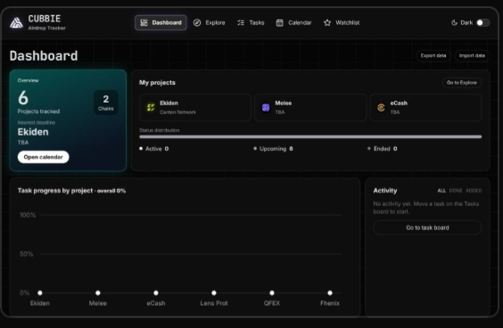

# ◈ Airdrop Tracker

<p align="center">
  
  
  
</p>

<p align="center">
  <strong>Track airdrop projects, deadlines, and tasks in one private workspace.</strong>
  <br />
  Deadlines, task checklists, personal notes, and a watchlist, all stored in your browser. No backend. No login.
</p>

<p align="center">
  <a href="https://dropwatch.web.id"><strong>↗ OPEN LIVE DEMO</strong></a>
  &nbsp; · &nbsp;
  <a href="https://github.com/ahmad-choirudin"><strong>GITHUB PROFILE</strong></a>
</p>

---

## ◈ FEATURES

<table>
  <tr>
    <td width="50%">
      <strong>01 / DASHBOARD</strong><br />
      Project count, nearest deadline, status distribution, task progress chart, and an activity log.
    </td>
    <td width="50%">
      <strong>02 / EXPLORE</strong><br />
      Search the project list, filter by chain and category, sort by deadline, date added, or priority, and switch between grid and list view.
    </td>
  </tr>
  <tr>
    <td width="50%">
      <strong>03 / TASK BOARD</strong><br />
      Kanban board (todo, doing, done) with drag and drop, priority and tag filters, search, and custom tasks.
    </td>
    <td width="50%">
      <strong>04 / CALENDAR</strong><br />
      Monthly deadline calendar, this week's list, overdue list, and reminders via browser notifications.
    </td>
  </tr>
  <tr>
    <td width="50%">
      <strong>05 / WATCHLIST</strong><br />
      Favorite projects with priority and personal notes.
    </td>
    <td width="50%">
      <strong>06 / PROJECT DETAILS</strong><br />
      Checklist, notes, wallet label, and links to the project website and X account.
    </td>
  </tr>
</table>

Fully responsive, so it works on both mobile and desktop.

## ◈ PREVIEW

<p align="center">
  <a href="https://dropwatch.web.id/">
    
  </a>
  <br />
  <sub>Dashboard preview</sub>
</p>

## ◈ TECH STACK

<p>
  
  
  
  
</p>

## ◈ GETTING STARTED

Requires Node.js 18 or newer.

```bash
npm install
npm run dev
```

Open the address shown in the terminal (usually `http://localhost:5173`). To access it from another device or from Codespaces, run it with `npm run dev -- --host`.

Other commands:

```bash
npm run build     # production build to the dist folder
npm run preview   # preview the production build
```

## ◈ PROJECT STRUCTURE

```text
src/
  App.jsx       # all UI and app logic
  data.json     # airdrop project list
  index.css     # extra styles and animations
  main.jsx      # entry point
  mascot.webp   # mascot image
```

## ◈ EDITING PROJECT DATA

The project list lives in `src/data.json`. Fields used by the app:

| Field | Meaning |
| --- | --- |
| `id` | Unique project ID |
| `n` | Project name |
| `c` | Chain |
| `k` | Category |
| `s` | Status: `Active`, `Upcoming`, or `Ended` |
| `i` | Verification: `Confirmed`, `Potential`, or `Unverified` |
| `dl` | Days until deadline (negative means overdue) |
| `ad` | Days ago the project was added |
| `v` | Days ago it was last verified |
| `r` | Project summary |
| `f` | Risk warning (optional) |
| `w` | Website URL |
| `x` | X account URL |

## ◈ DATA STORAGE

Tasks, favorites, priorities, notes, and the activity log are stored in the browser's localStorage under the keys `at-tasks2`, `at-watch`, and `at-log`.

> Clearing site data in your browser will erase everything. Nothing is sent to a server.

## ◈ SECURITY NOTES

- There is no guarantee that any project will distribute an airdrop. Do your own research.
- Never enter a seed phrase, private key, or full wallet address into this app. The wallet field is for labels only, for example "Main wallet".

## ◈ BUILT BY

**Ahmad Choirudin**

Web3 Research · Crypto Markets · DeFi · Frontend Development

<p align="center">
  <a href="https://ahmadchoirudin.my.id/">Portfolio</a>
  &nbsp; · &nbsp;
  <a href="https://dropwatch.web.id">Live Demo</a>
  &nbsp; · &nbsp;
  <a href="https://github.com/ahmad-choirudin">GitHub</a>
  &nbsp; · &nbsp;
  <a href="https://x.com/CubbieOG">X / @CubbieOG</a>
</p>
